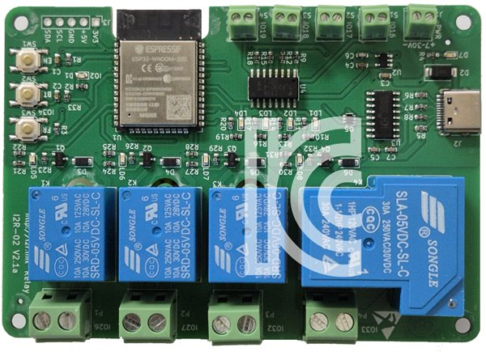
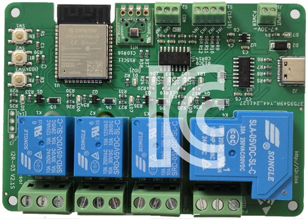
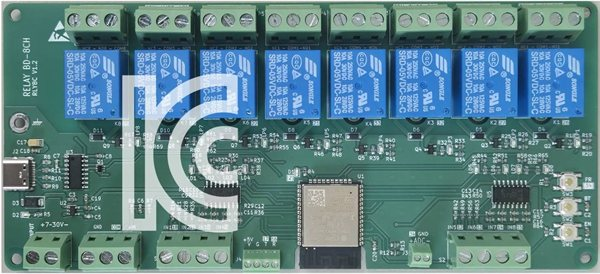

# I2R_PLC

i2r-02, i2r-03, i2r-04 IoT PLC(ESP32)를 위한 Arduino 라이브러리입니다.
보드 종류만 고르면 핀 번호를 몰라도 `input(1)`, `output(1, ON)`처럼 번호로 씁니다.

> **1.0.0** · 모든 함수와 예제를 i2r-03 보드에서 확인했습니다 (✅). i2r-02, i2r-04는 같은 코드에 핀 표만 다릅니다.
> 공개한 함수 이름은 바꾸지 않습니다. 원격 제어(Wi-Fi, MQTT)는 [I2R_IoT](https://github.com/kdi6033/I2R_IoT)와 함께 쓰는 헤더로 더할 예정입니다.

```cpp
#include <I2R_PLC.h>

I2R_PLC plc(I2R_03);   // I2R_02, I2R_03, I2R_04 중 하나

void setup() {
  plc.begin();
}

void loop() {
  plc.update();                       // loop 맨 앞에서 매번
  plc.output(1, plc.input(1));        // IN1이 들어오면 OUT1 켜기
  if (plc.rising(2)) plc.toggle(2);   // IN2를 누를 때마다 OUT2 켜고 끄기
}
```

## ✅ 지원 보드

<table>
<tr>
<th width="33%">i2r-02</th>
<th width="33%">i2r-03</th>
<th width="33%">i2r-04</th>
</tr>
<tr>
<td></td>
<td></td>
<td></td>
</tr>
<tr>
<td><code>I2R_PLC plc(I2R_02);</code></td>
<td><code>I2R_PLC plc(I2R_03);</code></td>
<td><code>I2R_PLC plc(I2R_04);</code></td>
</tr>
<tr>
<td>입력 4 (무전압 접점)<br>릴레이 4 (30A 1개, 10A 3개)</td>
<td>입력 4 (전압 입력, COM 사용)<br>릴레이 4 (30A 1개, 10A 3개)<br><b>AHT21 온습도 센서</b></td>
<td>입력 8 (무전압 접점)<br>릴레이 8</td>
</tr>
<tr>
<td><b>이럴 때</b><br>스위치, 버튼, 센서 접점으로 전등, 펌프, 환풍기를 켜고 끄기. 계단 조명, 물탱크 펌프처럼 장치가 몇 개인 곳</td>
<td><b>이럴 때</b><br>온도와 습도로 환풍기, 히터, 가습기를 제어. 비닐하우스, 축사, 창고, 서버실. 다른 장비가 보내는 전압 신호를 입력으로 받을 때</td>
<td><b>이럴 때</b><br>장치가 많은 곳. 여러 구역 조명, 여러 대의 모터와 밸브, 작은 생산 설비나 교육용 PLC 실습</td>
</tr>
</table>

- i2r-02, i2r-04 입력 단자에 따로 전압을 넣으면 고장 납니다. 스위치처럼 연결만 하세요.
- 보드별 핀 맵과 배선은 [i2r-plc 키트](https://github.com/kdi6033/i2r-plc)의 `boards` 폴더에 있습니다.

## ✅ 설치

1. Arduino IDE에 ESP32 보드 패키지(esp32 by Espressif, 3.0 이상)를 설치합니다.
2. Arduino IDE 왼쪽의 **라이브러리 매니저**에서 `I2R_PLC`를 찾아 **INSTALL**을 누릅니다.
3. 보드 설정: ESP32 Dev Module, Flash Size 8MB, Partition Scheme Huge APP

```
FQBN = esp32:esp32:esp32:FlashSize=8M,PartitionScheme=huge_app
arduino-cli lib install I2R_PLC
```

라이브러리 매니저에 아직 보이지 않으면(등록 직후), 이 저장소에서 **Code → Download ZIP**으로 내려받고 **스케치 → 라이브러리 포함하기 → .ZIP 라이브러리 추가**로 설치합니다.

## ✅ 함수

### 기본

| 함수 | 설명 | 상태 |
|---|---|:---:|
| `I2R_PLC plc(I2R_03)` | 보드 종류를 정해 만든다 | ✅ |
| `plc.begin()` | `setup()`에서 한 번. 핀 설정, 출력 모두 끄기, 센서 찾기 | ✅ |
| `plc.update()` | `loop()` 맨 앞에서 매번. 예약된 출력 처리, 입력 읽기, 떨림 제거, 센서 읽기 | ✅ |
| `plc.type()` | 보드 이름 `"i2r-02"`, `"i2r-03"`, `"i2r-04"` (옛 i2r 펌웨어의 type과 같음) | ✅ |
| `plc.board()` | 만들 때 정한 보드 종류 (`I2R_02`, `I2R_03`, `I2R_04`). `if (plc.board() == I2R_03)`처럼 비교 | ✅ |
| `plc.inputCount()`, `plc.outputCount()` | 입력, 출력 개수 (4 또는 8) | ✅ |

### 출력 (번호는 1부터)

| 함수 | 설명 | 상태 |
|---|---|:---:|
| `plc.output(n, ON)` / `plc.output(n, OFF)` | 출력 n 켜기 / 끄기. 없는 번호면 아무것도 켜지 않고 시리얼에 알린 뒤 `false` | ✅ |
| `plc.output(n, ON, 초)` | 켜고 정한 시간(초) 뒤 자동으로 끄기 (`update()`가 끔) | ✅ |
| `plc.output(n, ON, 기다림초, 동작초)` | 기다린 뒤 켜고, 동작 시간이 지나면 끄기. 동작초가 0이면 켜 둔 채로 둠 | ✅ |
| `plc.toggle(n)` | 출력 n을 반대로 | ✅ |
| `plc.allOff()` | 모든 출력 끄기 | ✅ |
| `plc.outputState(n)` | 출력 n이 켜져 있으면 `true` | ✅ |
| `plc.blink(n, 켜짐ms, 꺼짐ms)` | 출력 n을 계속 깜빡이기 (켜진 상태에서 시작). `output(n, OFF)`로 멈춤 | ✅ |
| `plc.remain(n)` | 예약된 출력이 바뀌기까지 남은 초 (올림). 예약이 없으면 0 | ✅ |

### 입력 (번호는 1부터)

| 함수 | 설명 | 상태 |
|---|---|:---:|
| `plc.input(n)` | 입력 n이 들어와 있으면 `true` (30ms 떨림 제거) | ✅ |
| `plc.rising(n)` | 입력 n이 막 들어온 순간에만 `true` | ✅ |
| `plc.falling(n)` | 입력 n이 막 꺼진 순간에만 `true` | ✅ |
| `plc.setDebounce(ms)` | 떨림 제거 시간 바꾸기 (기본 30ms) | ✅ |

### 타이머 (PLC식)

| 함수 | 설명 | 상태 |
|---|---|:---:|
| `plc.onDelay(n, ms)` | TON. 입력 n이 ms 동안 계속 들어와 있으면 `true`, 꺼지면 바로 `false` | ✅ |
| `plc.offDelay(n, ms)` | TOF. 입력 n이 들어와 있는 동안, 그리고 꺼진 뒤 ms 동안 `true` | ✅ |

### 카운터 (PLC식)

| 함수 | 설명 | 상태 |
|---|---|:---:|
| `plc.count(n)` | CTU. 입력 n이 들어온 횟수 (떨림 제거 뒤, `begin()`부터) | ✅ |
| `plc.resetCount(n)` | 입력 n의 횟수를 0으로 | ✅ |

### 상태 알리기 (원격 제어용)

| 함수 | 설명 | 상태 |
|---|---|:---:|
| `plc.onOutputChange(함수)` | 출력이 실제로 바뀔 때마다 `함수(n, on)`을 부름. 자동 끄기, 늦게 켜기, 깜빡임도 알림 | ✅ |
| `plc.inputBits()` | 모든 입력 상태를 숫자 하나로 (bit0 = IN1). 바뀌었는지 비교할 때 | ✅ |
| `plc.outputBits()` | 모든 출력 상태를 숫자 하나로 (bit0 = OUT1) | ✅ |
| `plc.outputBits(값)` | 모든 출력을 한꺼번에 바꾸기 (예약, 깜빡임은 취소) | ✅ |
| `plc.inputText()`, `plc.outputText()` | `"0101"` 문자 (맨 왼쪽이 1번, 1 = 켜짐). 보내거나 시리얼로 볼 때 | ✅ |

### 보드

| 함수 | 설명 | 상태 |
|---|---|:---:|
| `plc.led(ON)` | 보드 내장 LED | ✅ |
| `plc.button()` | 공장 초기화 버튼이 눌려 있으면 `true` | ✅ |
| `plc.temperature()`, `plc.humidity()` | i2r-03 온도(℃), 습도(%RH). 센서가 없으면 `NAN` | ✅ |
| `plc.sensorOk()` | 온습도 센서를 찾았으면 `true` | ✅ |

온습도는 라이브러리가 2초마다 읽어 둡니다. 따로 설치할 라이브러리는 없습니다.

## ✅ 예제

| 예제 | 내용 | 상태 |
|---|---|:---:|
| OutputTest | 보드 이름, 켜기/끄기, 자동 끄기, 늦게 켜기, 없는 번호 알림 확인 | ✅ |
| InputTest | 입력이 들어오는/꺼지는 순간, 들어온 횟수(떨림 확인), 전체 입력 상태 보기 (출력은 안 씀) | ✅ |
| DebounceTest | 떨림 제거 시간(setDebounce)을 시리얼에서 숫자로 바꿔 가며 눌린 횟수 비교 (출력은 안 씀) | ✅ |
| OutputBlink | 출력을 1초씩 차례로 켜기 | ✅ |
| InputToOutput | 입력이 들어오면 같은 번호의 출력 켜기 | ✅ |
| ToggleSwitch | IN1을 누를 때마다 OUT1 켜고 끄기 | ✅ |
| StairLight | IN1이 꺼진 뒤에도 5초 더 OUT1 켜 두기 (TOF) | ✅ |
| OnDelay | IN1을 3초 넣고 있어야 OUT1 켜기 (TON) | ✅ |
| TempRelay | 30도 이상 OUT1 켜기, 28도 이하 끄기 (i2r-03) | ✅ |
| BoardCheck | 입력, 출력, 버튼, 온습도를 1초마다 시리얼로 보기 | ✅ |
| Counter | IN1이 5번 들어오면 OUT1 켜기, IN2로 처음부터 (CTU) | ✅ |
| BlinkOutput | IN1이 들어오면 OUT1 깜빡이기, IN2로 멈춤 | ✅ |
| StateReport | 출력이 바뀔 때 알림, 입력이 바뀔 때만 보여 주기, 남은 시간, 시리얼로 `1010` 넣어 출력 한꺼번에 바꾸기 | ✅ |

예제는 `I2R_PLC plc(I2R_03);`로 되어 있습니다. 내 보드에 맞게 `I2R_02`나 `I2R_04`로 바꾸세요.

## ✅ 번호 규칙 (i2r 프로토콜과의 관계)

**사람이 읽고 쓰는 것은 1부터, 기계끼리 주고받는 것은 0부터**입니다.

| 1부터 (사람) | 0부터 (기계, i2r 프로토콜 JSON) |
|---|---|
| 보드 인쇄 `OUT1`, 화면 `스위치 1` | 명령 `{"c":"so","n":0,"v":1}` |
| 이 라이브러리 `plc.output(1)`, `plc.input(1)` | 상태 `"out":[1,0,0,0]`의 맨 앞 (`out[0]`) |
| `plc.onOutputChange` 의 `n` | `plc.outputBits()`의 bit0 |

`plc.output(1)` = `OUT1` = JSON `"n":0` = `out[0]` 입니다. 내 스케치에서는 늘 1부터 쓰고, JSON과의 변환은 원격 제어 헤더(I2R_IoT와 함께 쓰는 `I2R_PLC_IoT.h`, 만들 예정)가 맡습니다.

## ✅ 주의

- i2r-04의 IN5(GPIO 12)는 ESP32 부팅 설정 핀입니다. 전원을 켜는 순간 IN5가 들어와 있으면 부팅이 안 될 수 있습니다.
- i2r-04는 GPIO 21, 22를 릴레이 출력으로 쓰므로 I2C 센서를 달려면 다른 핀을 써야 합니다.
- i2r-04의 전압 센서(GPIO 34, 35)는 아직 라이브러리에 없습니다. 센서 함수를 만들 때 넣습니다.

## ✅ 라이선스

MIT License, i2r
